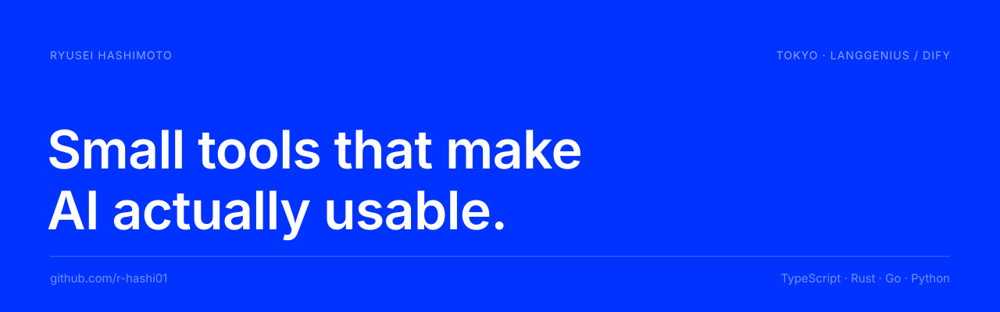

<a href="https://x.com/ryu_has03"></a>
<a href="https://github.com/langgenius"></a>


## About

```ts
const ryusei = {
  company:  "LangGenius (Dify)",
  location: "Tokyo, Japan",
  focus:    ["LLM workflows", "AI agents", "developer tooling", "document editors"],
  stack:    ["TypeScript", "Rust", "Go", "Python"],
};
```

## Stack


## Projects

<table>
  <tr>
    <td width="50%" valign="top">
      <sub>01 · GO / TS / PYTHON</sub>
      <h3><a href="https://github.com/r-hashi01/kairo">kairo</a></h3>
      <p>Durable workflows that run <b>inside your app</b>. No workflow server, no broker — a WASM core and your database.</p>
    </td>
    <td width="50%" valign="top">
      <sub>02 · RUST</sub>
      <h3><a href="https://github.com/r-hashi01/Fude">fude (筆)</a></h3>
      <p><b>The brush for AI-native document editors.</b> A Rust shell that pre-wires the hard parts of building one.</p>
      
    </td>
  </tr>
  <tr>
    <td width="50%" valign="top">
      <sub>03 · ASTRO</sub>
      <h3><a href="https://github.com/r-hashi01/astlide">Astlide</a></h3>
      <p><b>Slides that live in your Astro site.</b> Write decks as content, ship them with your site.</p>
      
      
    </td>
    <td width="50%" valign="top">
      <sub>04 · PYTHON · DIFY</sub>
      <h3><a href="https://github.com/r-hashi01/skills-to-dify-workflow">skills-to-dify-workflow</a></h3>
      <p>Turn agent “skills” into production-ready <b>Dify workflows</b>.</p>
      
    </td>
  </tr>
  <tr>
    <td width="50%" valign="top">
      <sub>05 · TAURI</sub>
      <h3><a href="https://github.com/r-hashi01/mdeditor">mdeditor</a></h3>
      <p>A fast, native Markdown editor built with Tauri v2. macOS / Linux / Windows.</p>
      
    </td>
    <td width="50%" valign="top">
      <sub>06 · TYPESCRIPT</sub>
      <h3><a href="https://github.com/r-hashi01/crispdf">crispdf</a></h3>
      <p>Browser-side DOM → PDF with high visual fidelity <b>and</b> selectable text.</p>
    </td>
  </tr>
</table>

<details>
<summary><b>More</b></summary>
<br/>

| Project | What it does |
| --- | --- |
| [remote-claude](https://github.com/r-hashi01/remote-claude) | Run Claude Code in a Cloudflare Sandbox instead of your local machine |
| [dify-dsl-validation](https://github.com/r-hashi01/dify-dsl-validation) | Structural validator for Dify Workflow DSL (YAML) |
| [wiki-plugin](https://github.com/r-hashi01/wiki-plugin) | Dify plugin that generates DeepWiki-style docs from a repository |

</details>

## Activity


<!-- Contribution snake (generated by .github/workflows/snake.yml) -->
<picture>
  <source media="(prefers-color-scheme: dark)" srcset="https://raw.githubusercontent.com/r-hashi01/r-hashi01/output/github-contribution-grid-snake-dark.svg" />
  
</picture>

---

<sub>Tokyo · <a href="https://dify.ai">https://dify.ai</a></sub>
